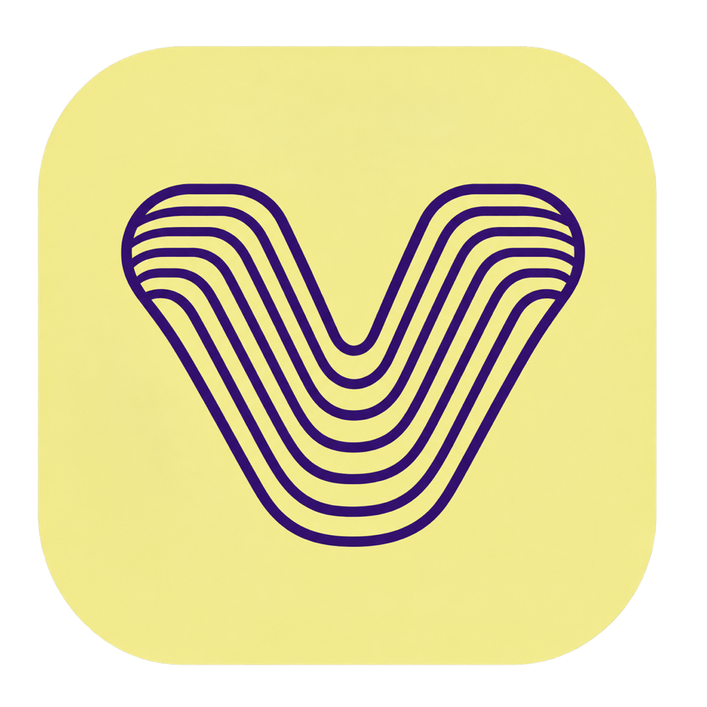

# Vectorio

A Rust desktop app for creating vector drawings for pen plotters.



Four workspaces share a single document:

- **Design**: single-line text, shapes, freehand drawing, layers, and independent inks.
- **Create**: scenes and generators with reproducible seeds, color sets, and live previews.
- **Volume**: OBJ/STL models, composable rendering passes, shadows, reading maps, optical mixing, isolines, perspective, and multiview sheets. 3D objects retain their editable recipes.
- **Output**: paths grouped by ink, simulation, scheduling with drying times, and SVG export in millimeters.

The interface supports Spanish and English. Installation and native controls are designed for macOS. Direct communication with a plotter is not implemented yet.

## Build and test

You need stable Rust, Python 3, and the Xcode command line tools on macOS.

```sh
cargo test --workspace --locked
cargo run --release -p vectorio-app
```

If Rust was installed through Homebrew and `cargo` is missing from your terminal:

```sh
export PATH="/opt/homebrew/opt/rustup/bin:$PATH"
```

## Install on macOS

### Download the installer

Download `Vectorio-<version>-arm64.dmg` from [Releases](https://github.com/gdx54/vectorio/releases), open it and drag **Vectorio** onto **Applications**. It requires a Mac with Apple silicon and macOS 11 or later.

The app is not notarized by Apple, so the first launch is blocked. Open **System Settings → Privacy & Security** and click **Open Anyway**, or run:

```sh
xattr -dr com.apple.quarantine /Applications/Vectorio.app
```

### Build from source

```sh
python3 scripts/install-macos.py
```

This installs or updates `/Applications/Vectorio.app`. The installed app runs its binary directly: it does not need to read the source project or rebuild at startup. An open window keeps its current version until the next launch. If the build fails, the installer preserves the previously installed version.

The generated app uses a local ad hoc signature. An Apple-notarized installer is not available yet.

To build the `.dmg` yourself, run `python3 scripts/build-dmg.py`; it is written to `target/dist/`.

## Disk usage

`target/` contains generated files and is excluded from Git. The development profile disables debug symbols and incremental compilation to limit its size. Compiled dependencies still take up space and can be rebuilt when needed.

```sh
cargo clean
```

This also removes examples and screenshots generated inside `target/`. Save any output you want to keep before running it. It does not remove the installed app or projects saved outside `target/`.

## Documentation

All project documentation is in English. Existing filenames are retained so that paths and links remain valid.

- [Features, installation, and keyboard shortcuts](LEEME.md).
- [Volume redesign plan](docs/plan-volumen-rediseno.md).
- [Volume architecture](VOLUMETRIC_ARCHITECTURE.md), [test coverage](VOLUMETRIC_TESTS.md), and [roadmap](VOLUMETRIC_ROADMAP.md).
- [Ink sets, optical mixing, and isolines](docs/volumen-ampliacion-g.md).
- [Output plan format](docs/formato-salida.md).

The core lives in `crates/vectorio-core`; the egui interface lives in `crates/vectorio-app`. `.vectorio` projects preserve objects, inks, and recipes. Historical plans describe the state and intentions at their recorded dates.

## Contributing

Ideas, fixes, new generators and effects, and builds for Windows or Linux are welcome. Only macOS has been tested so far. See [CONTRIBUTING.md](CONTRIBUTING.md).

## Licenses and credits

Vectorio is distributed under the [MIT license](LICENSE). Third-party fonts retain the [SIL Open Font License 1.1](crates/vectorio-core/fonts/OFL.txt). The FastMarchingTopoPlot adaptation retains its [Unlicense](third_party/FastMarchingTopoPlot/UNLICENSE). Notices for meshopt-rs and meshoptimizer are included in [VOLUMETRIC_NOTICES.txt](packaging/macos/VOLUMETRIC_NOTICES.txt).
